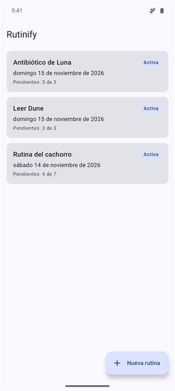
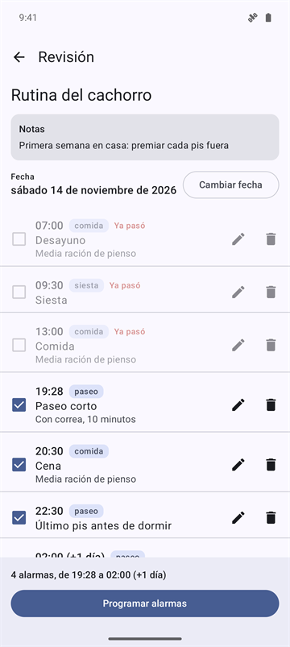

# Rutinify

Turn a routine written in plain language into local Android alarms.

You describe your day to any AI assistant (ChatGPT, Claude, Gemini…) using a prompt template the app gives you.
The assistant answers with a small JSON document; you paste it back into Rutinify, review it, and the app schedules
one exact alarm per activity. No backend, no account and no network access: everything stays on the phone.

> The app's user interface is in Spanish. Code, comments and commits are in English.

## Screenshots

| Home | New routine | Review | Order detail |
|:---:|:---:|:---:|:---:|
|  |  |  |  |

| Notification | Permissions | Dark theme |
|:---:|:---:|:---:|
|  |  |  |

## How it works

1. **New routine** → *Copiar plantilla* copies the prompt template. Paste it into your AI assistant together with your
   routine ("6:45 walk the puppy, 7:00 breakfast, nap at 9:30…").
2. Copy the assistant's answer and tap *Pegar del portapapeles* → *Validar*. The JSON may come wrapped in text or in a
   Markdown code block; Rutinify finds it and explains any error in plain Spanish.
3. **Review**: check the date, exclude, edit or remove activities. Past activities are flagged and skipped.
4. *Programar alarmas* asks for the notification and exact-alarm permissions when needed, warns about another routine
   on the same date (replace or keep both) and schedules the alarms.
5. Each alarm shows a notification in its category channel with **Hecho** (done) and **+5 min** (snooze).

## Features

- Tolerant JSON extraction and validation with clear, typed error messages and warnings.
- Review screen: date picker, include/exclude, edit, remove with undo, "use tomorrow" suggestion.
- Multi-day routines (up to 31 days) with `repeatDays` or per-item `dayOffset`: day headers in Review and in the order
  detail, date ranges in Home, and conflict detection by overlapping days.
- Exact alarms with `AlarmManager.setExactAndAllowWhileIdle`; falls back to a 10-minute window when the exact-alarm
  permission is denied.
- Order detail timeline: next alarm, status of each alarm, mark as done, delete with undo.
- Order actions: pause / resume, cancel all alarms, delete order, duplicate for another date.
- Robust rescheduling after reboot, time or time-zone change, app update, exact-alarm permission change and app start
  (alarms up to 15 minutes late still fire; later ones are skipped).
- Permissions screen and a Home banner while a permission is missing.
- Light and dark theme (dynamic color on Android 12+), adaptive and themed launcher icon.

## Use cases

Rutinify is not tied to any topic: it only sees times, titles and categories. Anything that can be expressed as
**"activities at specific times over one or more days"** works; the scenario lives in what you ask the AI.

| Scenario | What you might tell the AI | What helps |
|---|---|---|
| New puppy or pet | "3-month-old puppy: potty every 2 h, 4 meals, long naps" | Categories, after-midnight alarms, an assignee per task |
| Reading or study plan | "Read *Dune* in 10 days: 40 min in the morning, 30 at night" | Duplicate for another date, notes with today's chapter |
| Focused work | "Pomodoro blocks from 9 to 13, check email at 12" | Many alarms in one day, +5 min when you need to finish |
| Medication or care | "Antibiotic every 8 h for 7 days, a pill with breakfast" | `repeatDays`, exact timing, *Hecho* as a record of what was taken |
| Baby care | "Feed every 3 h, bath at 19:30, nap at 13:00" | Night alarms, several caregivers |
| Fitness or diet | "Training day: water every hour, post-gym meal at 14:00" | One category per kind of task |
| Events or moving day | "Truck at 8, keys at 12, internet install at 16" | Replace the plan if it changes, cancel all in one tap |
| Family mornings | "Wake up 6:30, breakfast 7:00, leave for school 7:40" | Pause on weekends or holidays |
| Step-by-step cooking | "Bread: knead at 9, first rise 1 h, oven at 13:00" | Close alarms with instructions in the description |

Current limits (v1.1): a routine covers up to 31 days (`dayOffset` 0–30, or `repeatDays` up to 30); there is no
open-ended repetition ("every Monday"); relative intervals must become fixed times; alarms are high-priority
notifications, so they do not ring like an alarm clock and "Do not disturb" silences them; on Android 14+ the
exact-alarm permission is off by default, so most users get a 10-minute window until they enable it; creating a plan
takes several copy-and-paste steps; a scheduled plan cannot be shifted; plans are not shared between phones; and
`assignee` is stored but has no effect yet. The [roadmap](#roadmap) addresses each of these.

## JSON contract (schema 1)

```json
{
  "schemaVersion": 1,
  "routine": { "name": "Rutina del cachorro", "date": "2026-11-05", "notes": "Primer día en casa" },
  "items": [
    { "time": "06:45", "dayOffset": 0, "title": "Sacar a hacer pis", "description": "Paseo corto",
      "durationMin": 10, "category": "paseo", "assignee": "Johan" },
    { "time": "02:00", "dayOffset": 1, "title": "Pis de madrugada", "description": null,
      "durationMin": 5, "category": "paseo", "assignee": null }
  ]
}
```

- `date` may be `null`: the app picks today (or tomorrow if nothing is left today) and says so.
- `dayOffset` (0–30) is the day of the activity counted from the routine's date; `dayOffset: 1` is also how an
  activity "after midnight" is written.
- `routine.repeatDays` (1–30, v1.1) repeats every item that many days. With it, `dayOffset` may only be 0 or 1. The
  200-item limit counts the copies.

A 7-day antibiotic, three doses a day:

```json
{
  "schemaVersion": 1,
  "routine": { "name": "Antibiótico de Luna", "date": "2026-11-16", "repeatDays": 7 },
  "items": [
    { "time": "06:00", "title": "Antibiótico", "description": "Con un poco de comida", "category": "medicación" },
    { "time": "14:00", "title": "Antibiótico", "description": "Con un poco de comida", "category": "medicación" },
    { "time": "22:00", "title": "Antibiótico", "description": "Con un poco de comida", "category": "medicación" }
  ]
}
```

Review then groups the 21 alarms by day ("Día 1 · lunes 16 de noviembre"), Home shows the range, and a routine that
overlaps those days asks whether to replace it or keep both. When each day is different (a tapering dose), write
every item with its own `dayOffset` instead.
- Limits: 1–200 items (after `repeatDays`), title ≤ 80 characters, ≤ 10 distinct categories, ≤ 500 pending alarms in the app.

The full contract is in [`specs/design.md`](specs/design.md) §4 and the prompt template in
[`app/src/main/res/raw/prompt_template.txt`](app/src/main/res/raw/prompt_template.txt).

## Permissions

| Permission | Why |
|---|---|
| `POST_NOTIFICATIONS` | Show each alarm with its actions (Android 13+). |
| `SCHEDULE_EXACT_ALARM` | Ring at the exact minute (Android 12+). Optional: without it alarms may be a few minutes late. |
| `RECEIVE_BOOT_COMPLETED` | Restore alarms after a reboot. |

The app does **not** request `INTERNET`.

## Tech stack

- Kotlin, Jetpack Compose (Material 3), Navigation Compose with type-safe routes
- MVVM with a pure-Kotlin domain layer (one use case per action), single `:app` module
- Hilt, Room, kotlinx.serialization, Coroutines + Flow
- `AlarmManager` + `BroadcastReceiver`s (no WorkManager for firing)
- Tests: JUnit 4, Truth, Turbine, kotlinx-coroutines-test, Robolectric; coverage with Kover
- AGP 9 (built-in Kotlin), `minSdk 28`, `targetSdk 36`

## Project structure

```
app/src/main/java/com/mirkwood/rutinify
├── domain/     models, use cases, repository and scheduler interfaces (no Android imports)
├── data/       Room, JSON importer, AlarmManager scheduler, notifications, receivers
├── di/         Hilt modules
└── ui/         Compose screens: home, newroutine, review, orderdetail, permissions
specs/          requirements.md (what), design.md (how), tasks.md (work order), manual-test.md
```

## Build and test

Requires Android Studio (or JDK 17+ and the Android SDK 36). On Windows use `gradlew.bat`.

```bash
./gradlew assembleDebug        # build the debug APK
./gradlew testDebugUnitTest    # JVM unit tests (Room and receivers via Robolectric)
./gradlew lintDebug            # Android lint
./gradlew koverVerify          # line coverage ≥ 80 % on domain + JSON importer
./gradlew installDebug         # install on a connected device or emulator
```

## Status

Version 1.1 (multi-day routines) is complete: all 37 tasks in [`specs/tasks.md`](specs/tasks.md) are done, 551 unit
tests pass, lint has no project warnings, coverage of the domain and importer is 99.2 %, and the manual checklist in
[`specs/manual-test.md`](specs/manual-test.md) passes on an Android 16 emulator.

Not included (see `specs/design.md` §15): calling a cloud AI API, `.ics` export, a standalone Wear OS app and
syncing plans through a server. Recurring routines, the widget, sharing between phones and the English UI are on the
[roadmap](#roadmap).

## Roadmap

Since v1.2 the product focus is **care plans with fixed times and a limited duration** (puppy, baby, medication,
post-surgery), not general productivity. The full requirements are in [`specs/requirements.md`](specs/requirements.md)
(R-14 to R-24) and the work order in [`specs/tasks.md`](specs/tasks.md) (phases 11–14).

### v1.2 · Usable by others

Goal: anyone can create a plan in a few taps, and important activities ring like a real alarm.

| Feature | Status |
|---|---|
| Share the AI's answer to Rutinify (`ACTION_SEND`) and send the template to any AI app ("Abrir en IA") | Planned |
| Real alarm mode for "critical" categories: full-screen alarm over the lock screen, alarm sound, `setAlarmClock` | Planned |
| Prompt templates per scenario: puppy, medication, baby, study, generic | Planned |
| "Order" renamed to "Plan" in the UI | Planned |
| English UI | Planned |

### v1.3 · User validation

Goal: check with real users that the care focus works before adding more features.

| Feature | Status |
|---|---|
| Closed test on Google Play (12+ testers for 14 days in a row) and release checklist | Planned |
| Success metric: the user creates a second plan | Planned |
| Optional local diagnostics (counters, no network), exported by hand from Settings | Planned |

### v1.4 · Care niche

Goal: cover what caregivers need day to day.

| Feature | Status |
|---|---|
| "Voy tarde": shift all pending alarms of a plan; edit a single alarm | Planned |
| Share a plan with another caregiver by QR code or text, no server; "only my tasks" filter by assignee | Planned |
| History ("19 of 21 done") exported as text or PDF for the vet or the doctor | Planned |
| "Up next" home-screen widget with a Done button | Planned |

### v2.0 · Differentiation

Goal: features that general-purpose AI assistants and planners do not offer together.

| Feature | Status |
|---|---|
| On-device conversion with Gemini Nano on supported phones (falls back to copy and paste) | Planned, pending a check on the `INTERNET` permission |
| JSON schema v2 with open-ended repetition (weekdays, optional end date), scheduling 7 days ahead | Planned |
| Wear OS: Done and +5 min from the watch (bridged notifications) | Planned |

## How this project is developed

Spec-driven: every change is backed by a requirement (`R-x.y`) and a task (`T-xx`), tests come first for domain logic,
and minor decisions are logged in `specs/design.md` §14. See [`CLAUDE.md`](CLAUDE.md) for the full working rules.

## License

[MIT](LICENSE)
