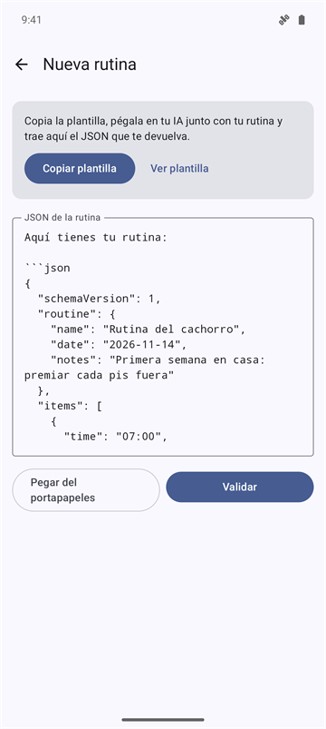
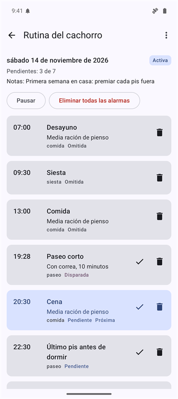
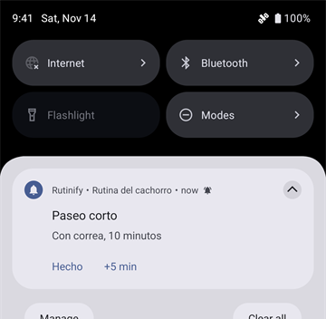
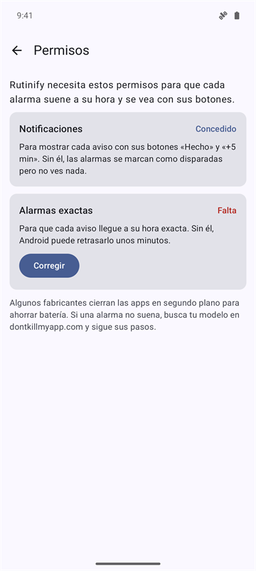
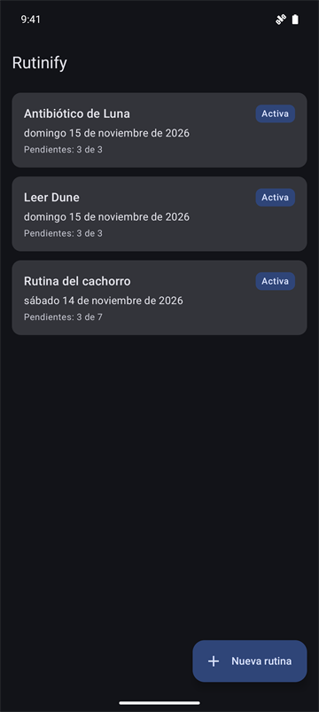

# Rutinify

Turn a routine written in plain language into local Android alarms.

You describe your day to any AI assistant (ChatGPT, Claude, Gemini…) using a prompt template the app gives you.
The assistant answers with a small JSON document; you paste it back into Rutinify, review it, and the app schedules
one exact alarm per activity. No backend, no account and no network access: everything stays on the phone.

The focus is **care plans with fixed times**: a new puppy, a baby, a course of medication, post-surgery care.

> The user interface is in Spanish and English (it follows the phone's language). Code, comments and commits are in
> English.

## Screenshots

| Home | New routine | Review | Order detail |
|:---:|:---:|:---:|:---:|
|  |  |  |  |

| Notification | Permissions | Dark theme |
|:---:|:---:|:---:|
|  |  |  |

## How it works

1. **New routine** → pick a scenario (puppy, medication, baby, study or generic) and tap *Abrir en IA* to send the
   prompt template to your AI app, or *Copiar plantilla* to paste it yourself, together with your routine ("6:45 walk
   the puppy, 7:00 breakfast, nap at 9:30…").
2. Share the assistant's answer to Rutinify from the AI app, or copy it and tap *Pegar del portapapeles* → *Validar*.
   The JSON may come wrapped in text or in a Markdown code block; Rutinify finds it and explains any error in plain
   words. On phones with Gemini Nano, *Convertir en el teléfono* does this step on the device, with no AI app at all.
3. **Review**: check the date, exclude, edit or remove activities. Past activities are flagged and skipped.
4. *Programar alarmas* asks for the notification and exact-alarm permissions when needed, warns about another plan on
   the same days (replace or keep both) and schedules the alarms.
5. Each alarm shows a notification with **Hecho** (done) and **+5 min** (snooze). Activities in a *critical*
   category ring like an alarm clock instead, full screen over the lock screen, with **Silenciar** as well.

## Features

**Creating a plan**

- Tolerant JSON extraction and validation with clear, typed error messages and warnings.
- Five scenario prompt templates in each language; share to and from AI apps (`ACTION_SEND`).
- On-device conversion with Gemini Nano (ML Kit GenAI Prompt API) where the phone supports it; the answer goes through
  the same validator as pasted text.
- Review screen: date picker, include/exclude, edit, remove with undo, "use tomorrow" suggestion.
- Multi-day plans (up to 31 days) with `repeatDays` or per-item `dayOffset`: day headers in Review and in the plan
  detail, date ranges in Home.
- **Recurring plans** (schema 2): a day type that repeats on chosen weekdays, with or without an end date. Alarms are
  created 7 days ahead and topped up every day; Review shows "N alarmas por semana".
- Conflict detection by shared days, including the weekdays of recurring plans: replace the old plan or keep both.

**Alarms**

- Exact alarms with `AlarmManager.setExactAndAllowWhileIdle`; falls back to a 10-minute window when the exact-alarm
  permission is denied.
- Critical categories (chosen in Settings) use `setAlarmClock`, the alarm sound and a full-screen alarm that rings until
  you act; *Silenciar* stops the sound, and it stops by itself after 10 minutes.
- Robust rescheduling after reboot, time or time-zone change, app update, exact-alarm permission change and app start
  (alarms up to 15 minutes late still fire; later ones are skipped).
- Notifications are bridged to a paired Wear OS watch with the same actions (no watch app needed).

**Day to day**

- Plan detail timeline: next alarm, status of each alarm, mark as done, edit a single alarm, delete with undo.
- *Voy tarde*: shift all pending alarms of a plan later or earlier, with a preview first.
- Plan actions: pause / resume, cancel all alarms, delete, duplicate for another date.
- Share a plan with another caregiver by QR code or as text, no server; *Solo las tareas de…* keeps only one
  assignee's tasks.
- History ("19 de 21 hechas") exported as text or PDF for the vet or the doctor.
- "Up next" home-screen widget with a *Hecho* button.
- Optional local diagnostics (step counters, never sent anywhere), exported by hand from Settings.
- Permissions screen and a Home banner while a permission is missing.
- Spanish and English UI; light and dark theme (dynamic color on Android 12+), adaptive and themed launcher icon.

## Use cases

Rutinify is not tied to any topic: it only sees times, titles and categories. Anything that can be expressed as
**"activities at specific times over one or more days"** works; the scenario lives in what you ask the AI.

| Scenario | What you might tell the AI | What helps |
|---|---|---|
| New puppy or pet | "3-month-old puppy: potty every 2 h, 4 meals, long naps" | Categories, after-midnight alarms, an assignee per task |
| Reading or study plan | "Read *Dune* in 10 days: 40 min in the morning, 30 at night" | Duplicate for another date, notes with today's chapter |
| Focused work | "Pomodoro blocks from 9 to 13, check email at 12" | Many alarms in one day, +5 min when you need to finish |
| Medication or care | "Antibiotic every 8 h for 7 days, a pill with breakfast" | `repeatDays`, exact timing, *Hecho* as a record of what was taken |
| Baby care | "Feed every 3 h, bath at 19:30, nap at 13:00" | Night alarms, several caregivers |
| Fitness or diet | "Training day: water every hour, post-gym meal at 14:00" | One category per kind of task |
| Events or moving day | "Truck at 8, keys at 12, internet install at 16" | Replace the plan if it changes, cancel all in one tap |
| Family mornings | "Wake up 6:30, breakfast 7:00, leave for school 7:40" | Pause on weekends or holidays |
| Step-by-step cooking | "Bread: knead at 9, first rise 1 h, oven at 13:00" | Close alarms with instructions in the description |

Current limits: a non-recurring plan covers up to 31 days; a recurring plan repeats one day type by weekday (no
"every other day" or monthly rules); relative intervals ("every 3 hours from when she wakes up") must become fixed
times; on Android 14+ the exact-alarm permission is off by default, so non-critical alarms get a 10-minute window until
it is enabled; only critical categories get through "Do not disturb" (when it lets alarms through); and the watch shows
the phone's notifications, it has no app of its own.

## JSON contract

```json
{
  "schemaVersion": 1,
  "routine": { "name": "Rutina del cachorro", "date": "2026-11-05", "notes": "Primer día en casa" },
  "items": [
    { "time": "06:45", "dayOffset": 0, "title": "Sacar a hacer pis", "description": "Paseo corto",
      "durationMin": 10, "category": "paseo", "assignee": "Johan" },
    { "time": "02:00", "dayOffset": 1, "title": "Pis de madrugada", "description": null,
      "durationMin": 5, "category": "paseo", "assignee": null }
  ]
}
```

- `date` may be `null`: the app picks today (or tomorrow if nothing is left today) and says so.
- `dayOffset` (0–30) is the day of the activity counted from the routine's date; `dayOffset: 1` is also how an
  activity "after midnight" is written.
- `routine.repeatDays` (1–30, v1.1) repeats every item that many days. With it, `dayOffset` may only be 0 or 1. The
  200-item limit counts the copies.

A 7-day antibiotic, three doses a day:

```json
{
  "schemaVersion": 1,
  "routine": { "name": "Antibiótico de Luna", "date": "2026-11-16", "repeatDays": 7 },
  "items": [
    { "time": "06:00", "title": "Antibiótico", "description": "Con un poco de comida", "category": "medicación" },
    { "time": "14:00", "title": "Antibiótico", "description": "Con un poco de comida", "category": "medicación" },
    { "time": "22:00", "title": "Antibiótico", "description": "Con un poco de comida", "category": "medicación" }
  ]
}
```

Review then groups the 21 alarms by day ("Día 1 · lunes 16 de noviembre"), Home shows the range, and a routine that
overlaps those days asks whether to replace it or keep both. When each day is different (a tapering dose), write
every item with its own `dayOffset` instead.
- Limits: 1–200 items (after `repeatDays`), title ≤ 80 characters, ≤ 10 distinct categories, ≤ 500 pending alarms in the app.

### Schema 2: recurring plans

`schemaVersion: 2` adds `routine.recurrence`. The items are then one **day type**, repeated on the listed weekdays
from `date` on, up to `until` (inclusive) or with no end when `until` is `null`:

```json
{
  "schemaVersion": 2,
  "routine": {
    "name": "Paseos de Luna",
    "date": "2026-11-16",
    "recurrence": { "weekdays": ["MO", "WE", "FR"], "until": "2026-12-20" }
  },
  "items": [
    { "time": "07:30", "title": "Paseo de la mañana", "durationMin": 20, "category": "paseo", "assignee": "Ana" },
    { "time": "21:00", "title": "Paseo de la noche", "durationMin": 15, "category": "paseo", "assignee": "Luis" }
  ]
}
```

- `weekdays` uses `MO TU WE TH FR SA SU`; `until` may be `null` or a date not before `date`.
- `recurrence` needs schema 2 and cannot be combined with `repeatDays` above 1 or with a `dayOffset` above 1.
- Schema 1 documents keep working unchanged; shared and exported plans use schema 2 only when they repeat.
- The 500-alarm limit counts only the alarms of the 7-day window.

The full contract is in [`specs/design.md`](specs/design.md) §4. The five scenario prompt templates are in
[`app/src/main/res/raw/`](app/src/main/res/raw/) (Spanish) and [`raw-en/`](app/src/main/res/raw-en/) (English), as
`prompt_template_<scenario>.txt`.

## Permissions

| Permission | Why |
|---|---|
| `POST_NOTIFICATIONS` | Show each alarm with its actions (Android 13+). |
| `SCHEDULE_EXACT_ALARM` | Ring at the exact minute (Android 12+). Optional: without it alarms may be a few minutes late. |
| `USE_FULL_SCREEN_INTENT` | Show critical alarms full screen over the lock screen. Optional: without it they ring as a heads-up notification. |
| `RECEIVE_BOOT_COMPLETED` | Restore alarms after a reboot. |
| AICore `BIND_SERVICE` | Talk to Gemini Nano through the system's AICore service (added by ML Kit). |
| `WAKE_LOCK`, `FOREGROUND_SERVICE` | Added by WorkManager, which Glance uses to draw the widget. Rutinify never fires alarms with it. |

The app does **not** request `INTERNET`: the entries the QR scanner would add are removed from the manifest, and the
release manifest is checked for it.

## Tech stack

- Kotlin, Jetpack Compose (Material 3), Navigation Compose with type-safe routes
- MVVM with a pure-Kotlin domain layer (one use case per action), single `:app` module
- Hilt, Room (schema 5, with migration tests), kotlinx.serialization, Coroutines + Flow
- `AlarmManager` + `BroadcastReceiver`s (no WorkManager for firing)
- Jetpack Glance (widget), ZXing core + Google code scanner (QR), ML Kit GenAI Prompt API (Gemini Nano)
- Tests: JUnit 4, Truth, Turbine, kotlinx-coroutines-test, Robolectric; coverage with Kover
- AGP 9 (built-in Kotlin), `minSdk 28`, `targetSdk 36`

## Project structure

```
app/src/main/java/com/mirkwood/rutinify
├── domain/     models, use cases, repository and scheduler interfaces (no Android imports)
├── data/       Room, JSON importer, AlarmManager scheduler, notifications, receivers
├── di/         Hilt modules
└── ui/         Compose screens: home, newroutine, review, orderdetail, permissions, settings, alarm, widget
specs/          requirements.md (what), design.md (how), tasks.md (work order), manual-test.md,
                release-checklist.md
```

## Build and test

Requires Android Studio (or JDK 17+ and the Android SDK 36). On Windows use `gradlew.bat`.

```bash
./gradlew assembleDebug        # build the debug APK
./gradlew testDebugUnitTest    # JVM unit tests (Room and receivers via Robolectric)
./gradlew lintDebug            # Android lint
./gradlew koverVerify          # line coverage ≥ 80 % on domain + JSON importer
./gradlew installDebug         # install on a connected device or emulator
```

## Status

The roadmap up to v2.0 is implemented: 66 of the 71 tasks in [`specs/tasks.md`](specs/tasks.md) are done, 812 unit
tests pass, lint has no project warnings and line coverage of the domain and JSON importer is 97.1 %. The manual
checklist in [`specs/manual-test.md`](specs/manual-test.md) passes on an Android 16 emulator.

What is left needs real devices or people, not code:

| Task | What is missing |
|---|---|
| T-50, T-64 · v1.2 and v1.4 checks | Repeat the alarm, sharing and QR steps on real phones (two of them for QR), with ChatGPT and Gemini installed |
| T-53 · Release checklist | Decisions for the owner (R8, public e-mail, privacy policy URL); see [`specs/release-checklist.md`](specs/release-checklist.md) |
| T-54 · Closed test | Google Play closed test with 12+ testers for 14 days |
| T-70 · Wear OS | Try *Hecho*, *+5 min* and *Silenciar* from a paired watch |

On-device conversion has only been tested with a fake model: it needs a phone with Gemini Nano.

Not included (see `specs/design.md` §15): calling a cloud AI API, `.ics` export, a standalone Wear OS app and syncing
plans through a server.

## Roadmap

Since v1.2 the product focus is **care plans with fixed times and a limited duration** (puppy, baby, medication,
post-surgery), not general productivity. The full requirements are in [`specs/requirements.md`](specs/requirements.md)
(R-14 to R-24) and the work order in [`specs/tasks.md`](specs/tasks.md) (phases 11–14).

### v1.2 · Usable by others

| Feature | Status |
|---|---|
| Share the AI's answer to Rutinify (`ACTION_SEND`) and send the template to any AI app ("Abrir en IA") | Done |
| Real alarm mode for critical categories: full-screen alarm over the lock screen, alarm sound, `setAlarmClock` | Done |
| Prompt templates per scenario: puppy, medication, baby, study, generic | Done |
| "Order" renamed to "Plan" in the UI | Done |
| English UI | Done |

### v1.3 · User validation

| Feature | Status |
|---|---|
| Closed test on Google Play (12+ testers for 14 days in a row) and release checklist | Checklist ready; test pending |
| Success metric: the user creates a second plan | Counted by the diagnostics |
| Optional local diagnostics (counters, no network), exported by hand from Settings | Done |

### v1.4 · Care niche

| Feature | Status |
|---|---|
| "Voy tarde": shift all pending alarms of a plan; edit a single alarm | Done |
| Share a plan with another caregiver by QR code or text, no server; "only my tasks" filter by assignee | Done (QR between two real phones still to try) |
| History ("19 of 21 done") exported as text or PDF for the vet or the doctor | Done |
| "Up next" home-screen widget with a Done button | Done |

### v2.0 · Differentiation

| Feature | Status |
|---|---|
| On-device conversion with Gemini Nano on supported phones (falls back to copy and paste); no `INTERNET` needed | Done (not yet tried on a phone with Gemini Nano) |
| JSON schema v2 with open-ended repetition (weekdays, optional end date), scheduling 7 days ahead | Done |
| Wear OS: Done, +5 min and Silence from the watch (bridged notifications) | Done (not yet tried with a watch) |

## How this project is developed

Spec-driven: every change is backed by a requirement (`R-x.y`) and a task (`T-xx`), tests come first for domain logic,
and minor decisions are logged in `specs/design.md` §14. See [`CLAUDE.md`](CLAUDE.md) for the full working rules.

## License

[MIT](LICENSE)
